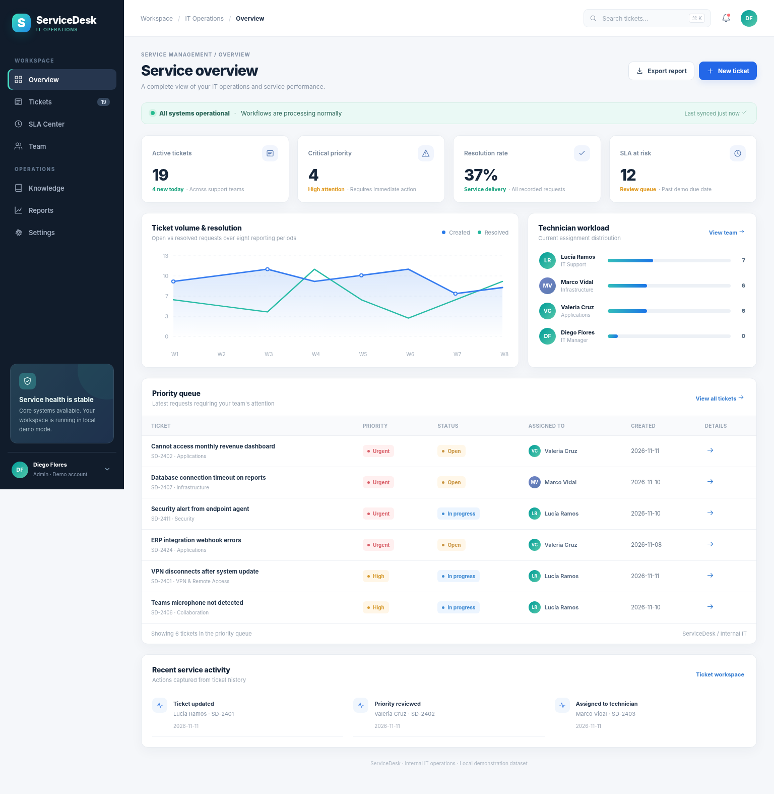
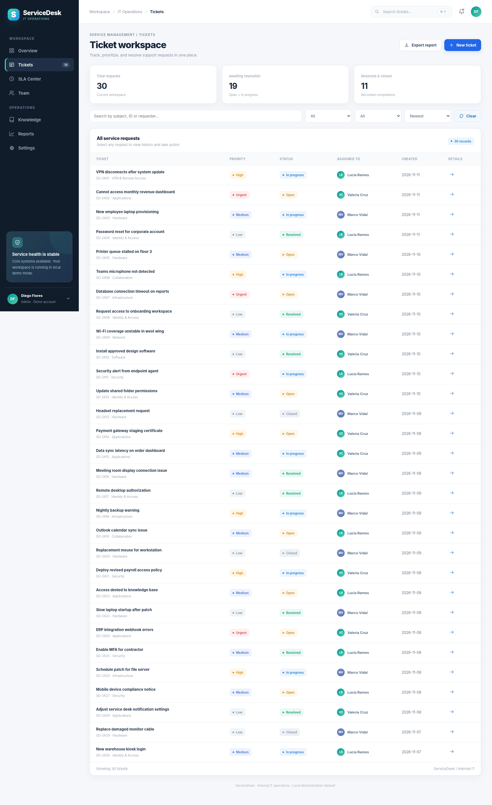
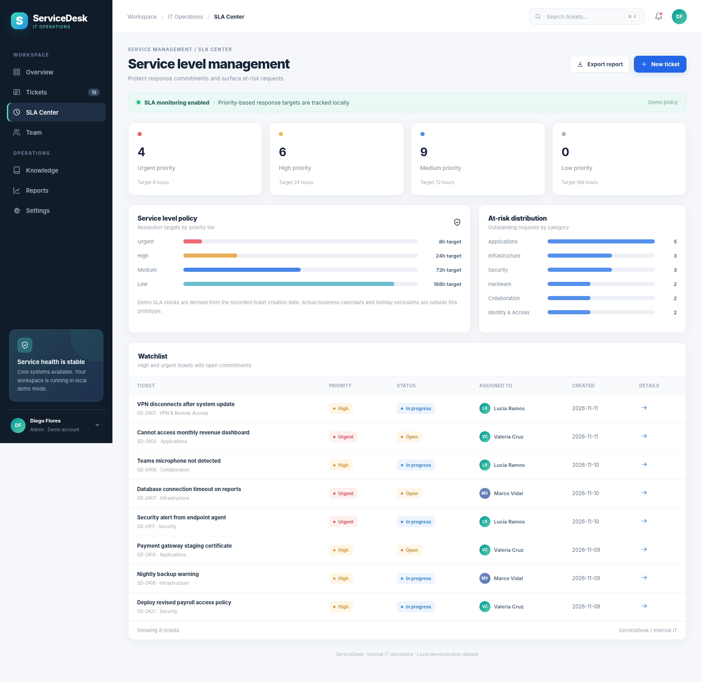
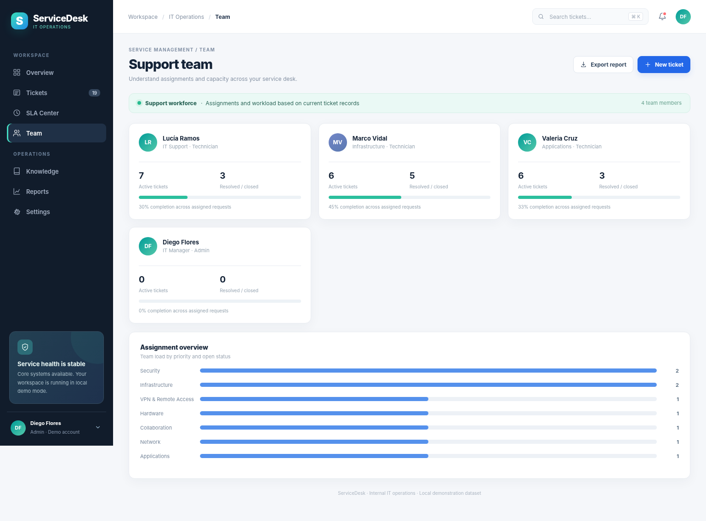
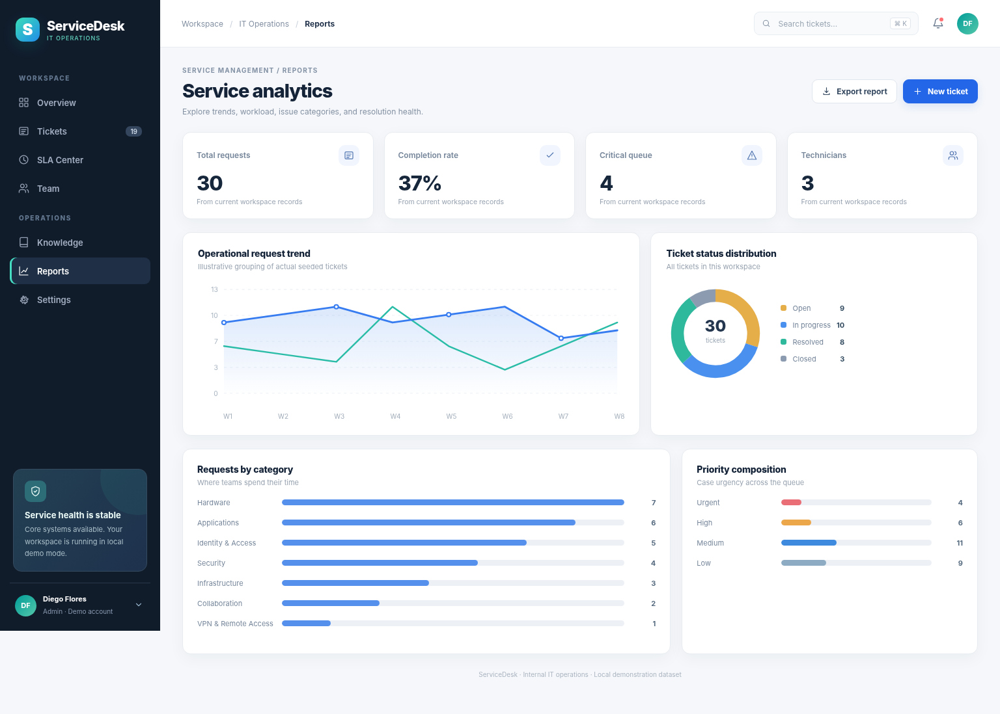
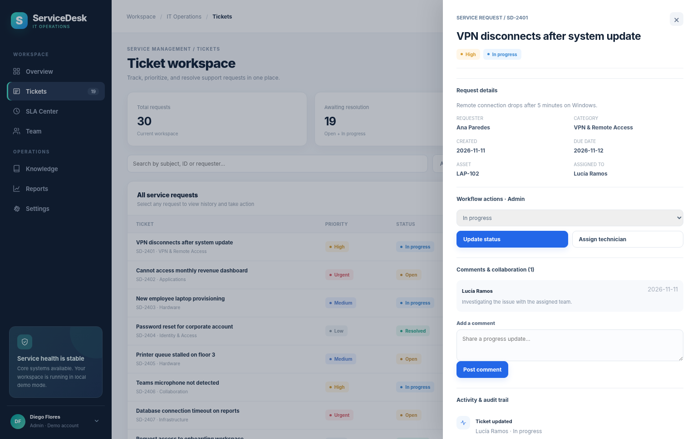
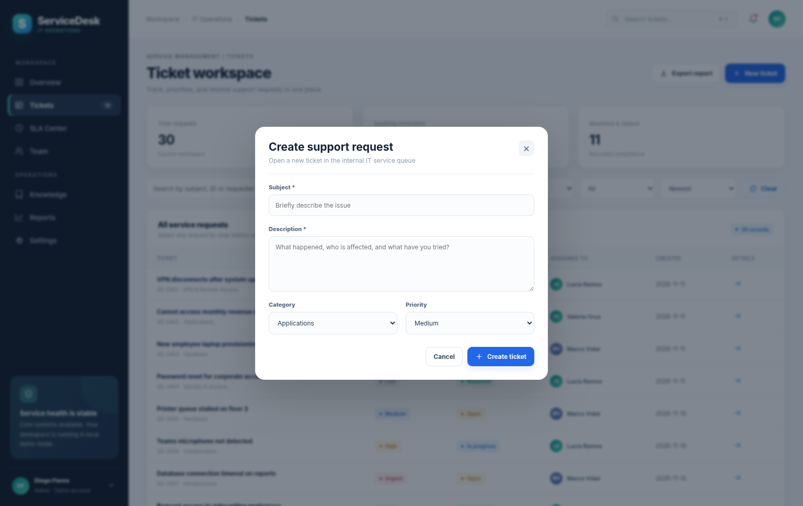
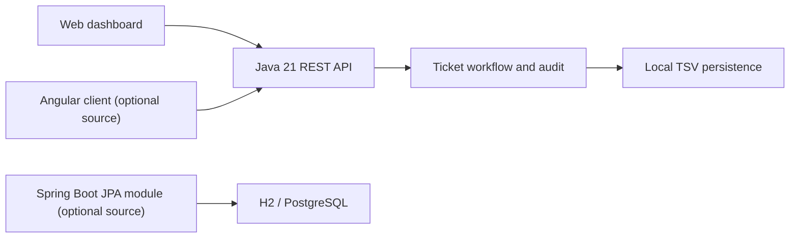

# ServiceDesk · IT Service Management

**A modern workspace for support requests, service priorities, team assignments and operational analytics.**

Built with Java 21 and a dependency-free REST reference server, with an additional Spring Boot / Angular implementation path for enterprise-stack development. Everything runs locally; there are no paid APIs or cloud services required.



<p>
  
  
  
  
  
</p>

## At a glance

| Capability | Implementation |
|---|---|
| Ticket lifecycle | Create, prioritize, view, update status and resolve tickets |
| Service workflow | Priority queues, technician assignment and role-dependent actions |
| Collaboration | Ticket-level comments and recorded activity history |
| SLA center | Priority-based resolution targets and watchlist |
| Operations | Team workloads, category statistics and status distribution |
| Reporting | On-screen analytics plus downloadable CSV |
| Demo environment | 30 realistic sample tickets, 7 users and resettable state |
| Local persistence | UTF-8 TSV files; no database service required for the verified reference app |

The current dataset, identities and organization are **fictional**. Role changes use demonstration headers rather than production authentication; do not expose the reference service publicly.

## Interface gallery

| Ticket workspace | Service level center |
|:--:|:--:|
|  |  |

| Support team | Service analytics |
|:--:|:--:|
|  |  |

| Ticket details | Create a ticket |
|:--:|:--:|
|  |  |

**Additional screens:** [Knowledge base](docs/screenshots/05-knowledge-base.png) · [Settings](docs/screenshots/07-workspace-settings.png) · [Mobile layout](docs/screenshots/10-mobile-overview.png)

*The screenshots were rendered from the real HTML/CSS/JavaScript client using a snapshot of the Java API's seeded data; the browser test environment did not permit direct navigation to localhost. No independent mock design was substituted for the application.*

## Quick start · working Java edition

**Requirements:** Java Development Kit (JDK) 21 or newer. The local reference edition has **zero external dependencies** and is the version compiled and integration-tested for this release.

On Windows, open PowerShell in the repository folder:

```powershell
.\run.ps1
```

On macOS or Linux:

```bash
./run.sh
```

Then open **http://localhost:8080**. Choose a demo role from the sidebar; the initial role is Admin (`Diego Flores`). You can create a ticket, assign it, change its status, add comments, export CSV, and restore the original dataset.

To run the tests (Python 3 is only needed for testing):

```powershell
python -m unittest discover -s tests -v
```

### Optional enterprise-stack modules

The repository also includes two **separate source modules**:

- [`server/springboot/`](server/springboot/) — Spring Boot 4.1 API using Spring Data JPA, H2 by default and an optional PostgreSQL profile.
- [`angular/`](angular/) — Angular 21 standalone application consuming the same API contract, with workspace, tickets, team, knowledge and reporting views.

These modules require Maven / Node.js / npm downloads. **They were authored but not built or runtime-validated in the creation environment**, which lacked Maven and access to dependency registries. For a fully verified first run, use the Java edition above. See the [framework setup notes](docs/FRAMEWORKS.md) for commands and compatibility requirements.

## High-level architecture



The two backend editions are alternatives: use the Java reference server for zero-dependency execution, or work toward integrating the Spring Boot JPA edition. They are **not** two servers running together in production.

## API endpoints

| Method | Path | Purpose |
|---|---|---|
| GET | `/api/health` | Liveness and storage mode |
| GET | `/api/bootstrap` | Tickets, users, activity, comments and knowledge entries |
| POST | `/api/tickets` | Submit a service request |
| PATCH | `/api/tickets/{id}/status` | Update a ticket state (Technician/Admin) |
| PATCH | `/api/tickets/{id}/assign` | Assign a technician (Admin) |
| POST | `/api/tickets/{id}/comments` | Add a comment |
| GET | `/api/export` | Download ticket CSV |
| POST | `/api/reset` | Restore demo fixtures (Admin) |

Create, update and comment requests use `application/x-www-form-urlencoded`. For demo permissions, pass `X-Demo-Role` and `X-Demo-User` headers. See [API examples](docs/API.md).

## Repository structure

```text
ServiceDesk/
├── web/                   # Verified responsive HTML/CSS/JS client
│   └── assets/
├── server/
│   ├── src/servicedesk/  # Dependency-free Java reference server
│   └── springboot/       # Optional Spring Boot + JPA source module
├── angular/               # Optional Angular standalone UI source module
├── data/seed/             # Synthetic tickets, comments and audit history
├── docs/screenshots/     # 10 browser-rendered captures
├── docs/                  # Architecture, API and framework setup
├── tests/                 # REST integration tests
├── .github/workflows/     # Automated Java compile and test checks
├── run.ps1                # Windows launcher
└── run.sh                 # Unix launcher
```

## Engineering notes

- The reference backend listens on **127.0.0.1** by default and persists to `data/runtime/` (ignored by Git).
- The API validates required ticket fields, priority values, status values and comments.
- Role restrictions are enforced in API request handlers, but the *role identity itself is user-supplied*. This is not secure authentication or authorization for untrusted users.
- SLA due dates are simplified continuous-hour targets; no holiday calendars, escalation policies, or email notifications are included.
- Knowledge articles contain metadata and sample view counts rather than a full CMS.
- Charts summarize the local demo dataset. They are not connected to production monitoring or an actual enterprise service desk.

More detail: [Technical design](docs/TECHNICAL.md) · [Test status](PROJECT_STATUS.md) · [Framework modules](docs/FRAMEWORKS.md).

## Autor y licencia

**Fanaker Labs** · Proyecto personal de desarrollo de software empresarial, gestión de soporte TI y APIs REST. Código bajo licencia [MIT](LICENSE).
