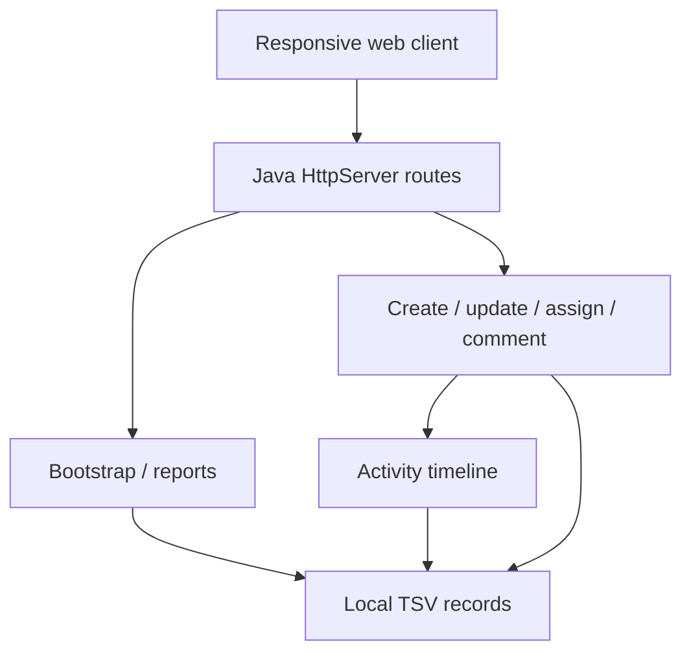

# Technical design · ServiceDesk

## Problem and scope

An IT support desk needs one location for incoming requests, work assignment, priority handling, employee communication and operational measurement. ServiceDesk provides a small but executable workflow for those processes using synthetic records, role-dependent actions and local persistence.

The application does **not** integrate with real corporate accounts, email, Active Directory, SSO, telephony, monitoring, external SLAs or ticketing vendors.

## Verified architecture

`Main.java` contains the dependency-free reference server, data model, input validation and API routes. This deliberate single-file composition simplifies local reproduction. Spring Boot and Angular sources exist in separate optional modules for a more framework-oriented variant; neither is required for the validated reference edition.

## Data records

| Collection | Primary attributes |
|---|---|
| Tickets | `id`, `title`, `description`, `category`, `priority`, `status`, `requester`, `assignee`, `created`, `updated`, `due`, `asset` |
| Events | `time`, `ticket`, `actor`, `action`, `detail` |
| Comments | `ticket`, `author`, `time`, `message` |
| Team members | `name`, `role`, `team`, `initials` (fixture data) |
| Knowledge articles | Example metadata, not an article CMS |

Initial fixtures live under `data/seed`. At runtime the server copies them to `data/runtime` on the first launch and writes changes there. Git ignores runtime data. Export CSV handles quoted text and header labels.

## Workflow invariants

- New tickets start in `Open` and `Unassigned`.
- Accepted priorities are `Low`, `Medium`, `High`, `Urgent`.
- Accepted states are `Open`, `In progress`, `Resolved`, `Closed`.
- Requester cannot change status or assignment.
- Technician can change status except to reopen a closed ticket; only Admin can change assignments or reset the dataset.
- Every create, status change, assignment or comment records a service event.
- Comment text and ticket fields are normalized for local TSV storage.

## Visual system

The interface uses a left navigation rail, a soft neutral workspace canvas, light KPI cards, priority/status chips and data-driven tables. Graphs use SVG generated from the local ticket collection. The responsive layout collapses the sidebar into horizontal navigation on narrow screens. No remote UI, icon or CSS assets are required.

## Operational trade-offs

- **Roles are not real authentication.** The API checks the supplied demo role header, but the header can be forged. This must not be used for production authorization.
- **TSV is simple local persistence**, not a concurrent enterprise database. The synchronized write path makes single-instance demo writes coherent but does not support multi-node operation.
- **SLA estimates are simplified.** Real-world business hours, pauses, escalation and breach rules are not represented.
- **Not all UI elements are operational.** Knowledge cards are metadata-only examples; activity records and tickets are interactive in their main flows. The reports screen intentionally uses an illustrative eight-period grouping derived from the seeded ticket collection rather than a real historical event warehouse.
- **The optional Spring Boot / Angular source is not release-tested**, because external build dependencies were not available in the creation environment. Run the framework setup commands before treating those modules as validated.

## Future production hardening

Use OIDC/SSO authentication and secure role assignments; replace TSV with managed PostgreSQL and real migrations; enforce workflow transition graphs; add queue consumers, email notifications, business calendar SLA evaluation, pagination, API-level rate limiting, structured logging and audit retention policies.
